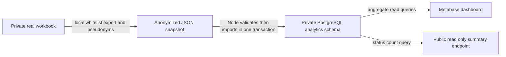

# Hanish job search analytics

This assessment project turns Hanish's real job-search workbook into a privacy-reduced PostgreSQL snapshot for Metabase. Hanish needs to see opportunity stages and recorded follow-up dates without exposing recruiters' details. Selfhost's team approved using the candidate's own real tracker by email on 22 October 2026. No club, friend or beneficiary interview is invented.

## Current verification status

Five local validation tests pass. On 25 October 2026, Metabase connected to the private project PostgreSQL database. Its supported CSV upload imported the real 127-record snapshot as model 40, Opportunities. The saved live SQL integrity query returned 127 records, 120 employer pseudonyms, 45 missing application dates and zero missing checked dates. A dashboard named Job search opportunity review and a status chart have been saved. Public sharing and the complete assessment submission are still pending.

The Node importer and summary endpoint below are an alternative prepared implementation: they have not been deployed. The actual live route is local whitelist export → CSV upload through Metabase → private PostgreSQL → saved questions/dashboard. See `metabase-live-queries.sql`. The server rejected an additional Linkdrop workload due to reserved memory; no server upgrade or deletion was performed.

## Data provenance and limits

`data/provenance.json` records extraction time, the private source workbook's SHA256, row counts and the transformation. `data/opportunities.json` and `.csv` contain real transformed records. They exclude company names, candidate names, recruiter contacts, URLs, email contents and free-text notes. Employer identifiers are pseudonyms. Role and location are coarse categories derived from the workbook.

These are **tracked opportunities**, including leads, holds, failures and closed roles. They are not all completed applications. A recorded application date does not prove delivery or selection. Do not use the public queue as permission to email someone: the original private thread must be checked first. Dates missing in the source remain null. This is a snapshot, not a live Gmail integration.

## Architecture

The private workbook never needs to be uploaded. Node owns the import and database views; Metabase owns the saved questions and dashboard. The public endpoint exposes aggregates only. There is no public write API.

## Reproduce

1. Use Node 20+ and PostgreSQL. Run `npm ci` and `npm test`.
2. Create a private project PostgreSQL database or use the assessment's existing database. Set `DATABASE_URL` or `PG_URL` in the platform's private environment variable settings, following `.env.example`. Never commit a real connection string.
3. Deploy this repo on the same project server as PostgreSQL and Metabase. The container listens on `0.0.0.0` and `PORT` (default3000).
4. Start with `npm start`. Startup validates the complete dataset, creates the `analytics` schema and imports its snapshot atomically. A failed import rolls back; a failed startup exits. Reimporting the same snapshot upserts stable IDs and removes rows absent from the authoritative snapshot inside the same transaction.
5. Verify `/healthz` returns200 only when PostgreSQL responds. `/api/summary` returns live SQL status counts; a database error returns503.
6. Add PostgreSQL in Metabase using the same verified internal host and port5432, never a public database port. Choose the `analytics` schema and create the four saved questions in `metabase-queries.sql`. Add them to a dashboard named `Job search opportunity review`.
7. Check SQL total equals `data/provenance.json.records`, status-chart totals equal that total, and a second startup does not duplicate rows. Verify public dashboard links from a signed-out session before including them in a submission.

The schema name is fixed and the insert values are parameterized. The import touches only `analytics.opportunities`, leaving Linkdrop's `public.links` unchanged. Do not use this importer on another production schema.

## AI assistance

Codex assisted with data transformation, importer, server, tests, deployment troubleshooting and documentation. All platform actions and final results must be reported from actual observations. The candidate should review and understand the code and record the required demonstration in their own voice.
